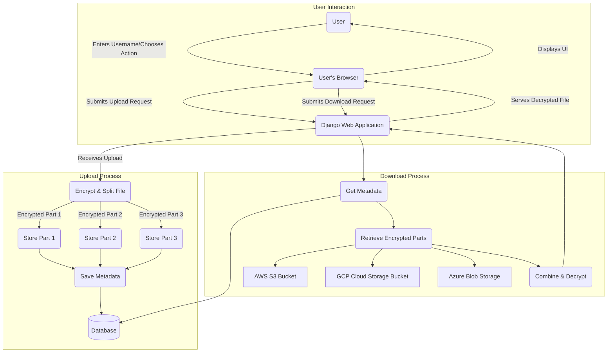

# Confidential Cloud Storage

A simple Django web application for securely uploading, storing, and downloading text files (`.txt`). The application uses Rabin's cryptosystem and splits encrypted files into three parts for storage.

## Features

* **User Association:** Files are associated with a username (currently based on session input).
* **Secure Upload:** Upload `.txt` files via a web interface.
* **Encryption:** Files are encrypted using Rabin's cryptosystem upon upload.
    * Two keys (primes `p` and `q`) are generated.
    * Key `p` is shown to the user as the "File Key" required for download.
    * Key `q` is stored in the database alongside file metadata.
* **File Splitting:** Encrypted files are split into three parts before storage.
* **Storage:** File parts are stored locally on the server's filesystem within the `media/chunks/` directory.
* **Download:** Users can provide the correct "File Key" (`p`) to decrypt their files.
* **File Deletion:** Users can delete their uploaded files and associated chunks.

## Technology Stack and Architecture Overview

* **Backend:** Python, Django
* **Encryption:** Custom implementation of Rabin's Cryptosystem (requires primes `p, q ≡ 3 mod 4`)
* **Web Server (Deployment):** Gunicorn
* **Reverse Proxy (Deployment):** Nginx
* **Database:** SQLite (default, configurable in `settings.py`)
* **Frontend:** HTML, CSS (basic styling)

## Configuration

Django's signing key and deployment settings are supplied through environment variables. The application refuses to start if `DJANGO_SECRET_KEY` is missing; it no longer falls back to a source-controlled key.

Generate a fresh key for each environment:

```bash
python -c "import secrets; print(secrets.token_urlsafe(50))"
```

For local development, export the generated key and enable debug mode:

```bash
export DJANGO_SECRET_KEY="<generated-key>"
export DJANGO_DEBUG=true
export DJANGO_ALLOWED_HOSTS=localhost,127.0.0.1,testserver
python manage.py migrate
python manage.py runserver
```

For production, set `DJANGO_SECRET_KEY` through the deployment platform's secret manager, set `DJANGO_DEBUG=false`, and set `DJANGO_ALLOWED_HOSTS` to the exact hostnames served by the application. When debug mode is disabled (the default), session and CSRF cookies are marked secure. Do not commit real secret values to the repository.

**Key rotation:** The signing key previously committed in `core/settings.py` must be treated as compromised. Generate and deploy a new key. Rotating it invalidates existing Django sessions, so users may need to sign in again.

> **Security note:** This project currently identifies file owners using a username stored in the session rather than authenticated Django users. The environment configuration above does not make that username-based ownership model suitable for production or multi-user confidential data.



## Core Logic

1. **Upload:**
   * User provides a username and selects a `.txt` file.
   * Server generates two prime numbers `p` and `q`, both congruent to 3 mod 4.
   * File content is encrypted character by character using Rabin's algorithm (`c = m² mod n`, where `n = pq`).
   * The encrypted file is split into three parts.
   * Metadata, including key `q` and part locations, is saved to the database.
   * Key `p` is displayed to the user.
2. **Download:**
   * User selects a file and supplies its File Key (`p`).
   * The server retrieves metadata and key `q`, combines the stored parts, decrypts the file, and serves the original `.txt` file.
